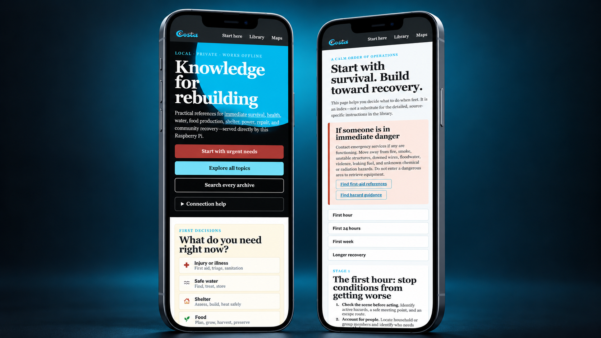
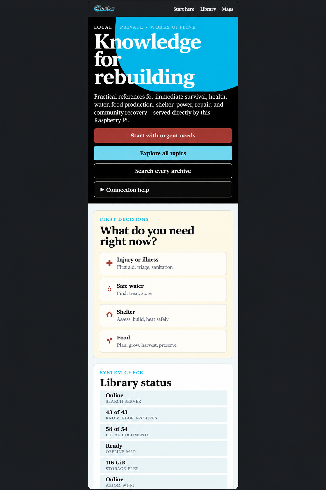
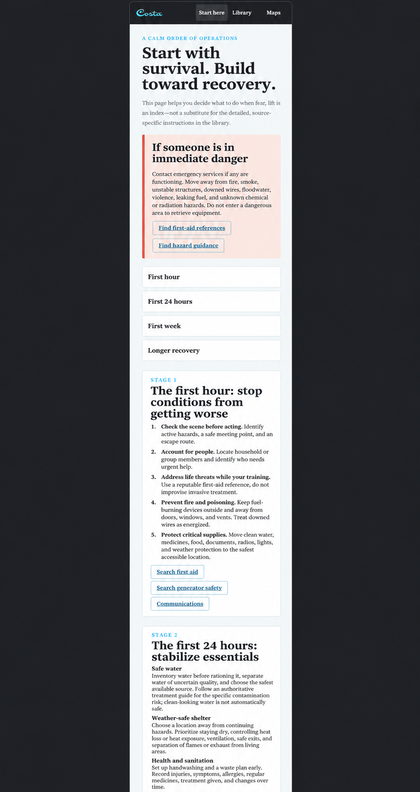

  

<h1 align="center">Costa Axiom Recovery Library</h1>

  A private, offline survival and rebuilding library that runs on a Raspberry Pi. 
  Connect with your phone. No internet required after setup.

  
  
  
  
  

## What this project does

Axiom turns a Raspberry Pi and a large SD card or SSD into a small offline
knowledge server. Ready-to-flash editions are available for **256GB, 512GB,
and 1TB** SD cards or SSDs, so you can choose the version that fits your storage
and the depth of content you want. The Pi creates its own Wi-Fi network named
**Axiom**. Connect your phone, open `http://10.10.10.1`, and use:

- first-aid, sanitation, food-growing, shelter, repair, power, communications,
  and community-recovery manuals;
- full illustrated English Wikipedia;
- searchable Kiwix archives;
- offline street maps for the United States, Puerto Rico, Canada, Mexico,
  Alaska, Hawaii, and U.S. territories;
- a step-by-step recovery guide designed for a phone screen.

## One box, two jobs: travel router and offline library

> **Axiom is useful every day—not only during a disaster.**

Connect the Pi's Ethernet port to a wired network with internet access and
Axiom shares that connection with phones, tablets, and computers on its private
**Axiom** Wi-Fi network. That means the same small device can serve as a handy
travel router in a hotel, cabin, workshop, RV, or temporary location.

If the internet connection fails—or there is no internet at all—the Axiom
Wi-Fi network and the entire local knowledge library **keep working**. You can
still open `http://10.10.10.1`, read the guides, search the offline archives,
and use the downloaded maps. No cloud service, subscription, or outside
connection is required for the offline features.

## 1. Choose the correct download

Choose by the **actual capacity of the card or SSD you will flash**. Do not put
the 512 GB or 1 TB edition on a 256 GB card.

| Edition | Best for | Included content | Download |
|---|---|---|---|
| **256 GB** | Lowest-cost complete setup | [OpenStreetMap](https://www.openstreetmap.org/) maps, 54 manuals, illustrated [Wikipedia](https://www.wikipedia.org/), medical, agriculture, repair, power, engineering, and practical collections | **[Download 256 GB image](https://github.com/Joe-CST/axiom-recovery-library/releases/download/v1.7.0/Costa-Axiom-Pi3-Pi4-Pi5-256GB-v1.7.0.img.xz)** |
| **512 GB** | Best balance of cost and depth | Everything in 256 GB, plus [Wiktionary](https://www.wiktionary.org/), [Wikiversity](https://www.wikiversity.org/), and the historical [Survivor Library](https://www.survivorlibrary.com/) | **[Download 512 GB image](https://github.com/Joe-CST/axiom-recovery-library/releases/download/v1.7.0/Costa-Axiom-Pi3-Pi4-Pi5-512GB-v1.7.0.img.xz)** |
| **1 TB** | Maximum offline library | Everything in 512 GB, plus [Khan Academy](https://www.khanacademy.org/) and [Project Gutenberg](https://www.gutenberg.org/) | **[Download 1 TB image](https://github.com/Joe-CST/axiom-recovery-library/releases/download/v1.7.0/Costa-Axiom-Pi3-Pi4-Pi5-1TB-v1.7.0.img.xz)** |

The image download is about 579 MiB. It is a compact installer. On first boot,
the Pi downloads and verifies the selected library. That first setup can take
many hours or several days depending on the edition and internet speed.

### What is in each edition?

| Feature | 256 GB | 512 GB | 1 TB |
|---|:---:|:---:|:---:|
| Pi 3B/B+, Pi 4B, and Pi 5B support | ✅ | ✅ | ✅ |
| Axiom Wi-Fi, mobile portal, SSH, and Ethernet sharing | ✅ | ✅ | ✅ |
| North America and Puerto Rico offline maps | ✅ | ✅ | ✅ |
| 54 practical manuals | ✅ | ✅ | ✅ |
| Full illustrated English Wikipedia | ✅ | ✅ | ✅ |
| Medical, agriculture, energy, repair, engineering, and practical Q&A | ✅ | ✅ | ✅ |
| Wiktionary and Wikiversity | ❌ | ✅ | ✅ |
| Historical Survivor Library | ❌ | ✅ | ✅ |
| Khan Academy | ❌ | ❌ | ✅ |
| Project Gutenberg | ❌ | ❌ | ✅ |
| Protected free-space reserve | 24 GiB | 48 GiB | 80 GiB |

[See the detailed edition comparison →](docs/IMAGE-EDITIONS.md)

## 2. What you need

At minimum:

- Raspberry Pi 3 Model B/B+, Pi 4 Model B, or Pi 5 Model B;
- a genuine 256 GB, 512 GB, or 1 TB card/SSD;
- the correct power supply for that Pi;
- an Ethernet cable and internet connection for the first setup;
- another computer for flashing the image.

For most people, the best low-cost combination is a **Pi 4 with a 256 GB
microSD card**. For the full library, use a **Pi 5, active cooling, and a
premium 1 TB A2/V30 microSD card**.

### Budget build

- [Raspberry Pi 4 Model B on Amazon](https://www.amazon.com/s?k=Raspberry+Pi+4+Model+B)
- **Budget storage:** [256 GB A2/U3 microSD card on Amazon](https://www.amazon.com/s?k=256GB+A2+U3+microSD+card)
- **Premium storage:** [256 GB high-endurance A2 microSD card on Amazon](https://www.amazon.com/s?k=256GB+high+endurance+A2+microSD+card)
- [Raspberry Pi 4 case with fan on Amazon](https://www.amazon.com/s?k=Raspberry+Pi+4+case+with+fan)
- [Official-style 15 W Pi 4 USB-C power supply on Amazon](https://www.amazon.com/s?k=Raspberry+Pi+4+official+15W+USB-C+power+supply)
- [Ethernet cable on Amazon](https://www.amazon.com/s?k=Cat6+Ethernet+cable)

### Premium build

- [Raspberry Pi 5 8 GB on Amazon](https://www.amazon.com/s?k=Raspberry+Pi+5+8GB)
- [Pi 5 active-cooling case on Amazon](https://www.amazon.com/s?k=Raspberry+Pi+5+active+cooler+case)
- [Official 27 W Pi 5 power supply on Amazon](https://www.amazon.com/s?k=Raspberry+Pi+5+official+27W+power+supply)
- **Budget storage:** [1 TB A2/U3 microSD card on Amazon](https://www.amazon.com/s?k=1TB+A2+U3+microSD+card)
- **Premium storage:** [1 TB A2/V30 microSD card from a recognized manufacturer on Amazon](https://www.amazon.com/s?k=1TB+A2+V30+microSD+card+SanDisk+Lexar+Kingston)
- [Ethernet cable on Amazon](https://www.amazon.com/s?k=Cat6+Ethernet+cable)

Want solar backup and protected storage? See the
[budget, premium, solar, battery, and weather-resistant hardware guide](docs/HARDWARE.md).
These are ordinary Amazon links, not affiliate links in this release. Prices
and sellers change; verify compatibility before buying.

## 3. Flash the image

1. Download the edition that matches your card or SSD.
2. Download and install [Raspberry Pi Imager](https://www.raspberrypi.com/software/).
3. Insert the card or connect the SSD to your computer.
4. Open Raspberry Pi Imager.
5. Click **Choose Device** and select your Raspberry Pi model.
6. Click **Choose OS**, then **Use custom**.
7. Select the downloaded `.img.xz` file. Do **not** extract it first.
8. Choose the correct storage device.
9. Click **Next**, then choose **No** when Imager offers OS customisation.
10. Confirm the erase and wait for writing and verification to finish.

Flashing erases the selected card or SSD. Double-check the device before you
confirm.

## 4. First boot

1. Put the card in the Pi, or connect the flashed SSD.
2. Connect the Pi to your router with Ethernet.
3. Connect stable power.
4. Leave the Pi running. Do not unplug it during installation.
5. The Pi creates the **Axiom** Wi-Fi network early in setup. The portal works
   while content continues downloading.
6. Installation is complete when `PREPPER_READY.txt` appears on the boot
   partition or the portal reports that the library is ready.

Downloads resume after a reboot or connection loss. The 1 TB edition can take
days on a slower connection.

## 5. Connect your phone

1. Open Wi-Fi settings on the phone.
2. Join **Axiom**.
3. Open Safari, Chrome, or another browser.
4. Visit **[http://10.10.10.1](http://10.10.10.1)**.
5. Add the page to the phone's home screen if desired.

<strong>Default credentials</strong>

- Wi-Fi name: `Axiom`
- Wi-Fi password: `AllWay$Preeped`
- Linux/SSH user: `prepper`
- Linux/SSH password: `Axiom-Prepper-2026`

These defaults are public because this is a public image. Change the Linux
password after setup with `passwd`. See [Security](SECURITY.md) for the hotspot
password command and safe deployment advice.

## See it on a phone

<table>
  <tr>
    <td width="50%" align="center"></td>
    <td width="50%" align="center"></td>
  </tr>
  <tr>
    <td align="center"><strong>Choose urgent needs or search the library</strong></td>
    <td align="center"><strong>Follow a calm recovery sequence</strong></td>
  </tr>
</table>

▶ **[Watch the 77-second phone walkthrough](docs/media/axiom-phone-demo.mp4)**

## More help

- [Complete installation guide](docs/INSTALL.md)
- [Edition comparison](docs/IMAGE-EDITIONS.md)
- [Hardware and off-grid shopping guide](docs/HARDWARE.md)
- [Troubleshooting](docs/TROUBLESHOOTING.md)
- [Security and changing passwords](SECURITY.md)
- [Release notes](CHANGELOG.md)

If something fails, open a [GitHub issue](https://github.com/Joe-CST/axiom-recovery-library/issues)
and include the Pi model, image edition, the last screen message, and the last
30 lines of `PREPPER-INSTALL.log`.

## Important safety note

This library is a reference collection, not a substitute for qualified medical,
structural, electrical, food-safety, or radiation-safety professionals. Some
historical archives are included for preservation and are clearly identified.
Check old advice against modern guidance before acting on it.

The nuclear material explains principles, radiation safety, and emergency
context. It is not a guide to building a reactor or radioisotope generator.

## Project status

Version **1.7.0** has software-level verification for all three editions,
including complete compressed-image decompression and SHA-256 comparison. The
mobile portal is tested at iPhone width. Physical hardware can vary, so test one
complete first boot before preparing multiple cards.

## About the creator

**Costa Axiom Recovery Library** is an independent project created and
maintained by [Jose Armando Costa](https://www.linkedin.com/in/jose-armando-costa),
a **Senior Software Development Manager at Amazon Web Services (AWS)**.

Jose creates practical, plain-English technology content that makes complex
systems easier to understand, build, and use. His work includes step-by-step
tutorials, open-source projects, hardware recommendations, architecture
guidance, troubleshooting, security practices, and affordable alternatives for
different budgets. He focuses on turning technical ideas into useful solutions
for developers, makers, technology enthusiasts, families, and small
organizations.

Costa Axiom Recovery Library is one example of that work: an open-source
project that turns a Raspberry Pi into an offline knowledge server and travel
router. Across his work, Jose emphasizes accessibility, reliability,
responsible engineering, and instructions people can confidently follow
without advanced technical experience.

- [Connect with Jose on LinkedIn](https://www.linkedin.com/in/jose-armando-costa)
- [See more projects from Joe-CST on GitHub](https://github.com/Joe-CST)

This is a personal, independent project. It is not sponsored by, affiliated
with, or endorsed by Amazon or AWS.
